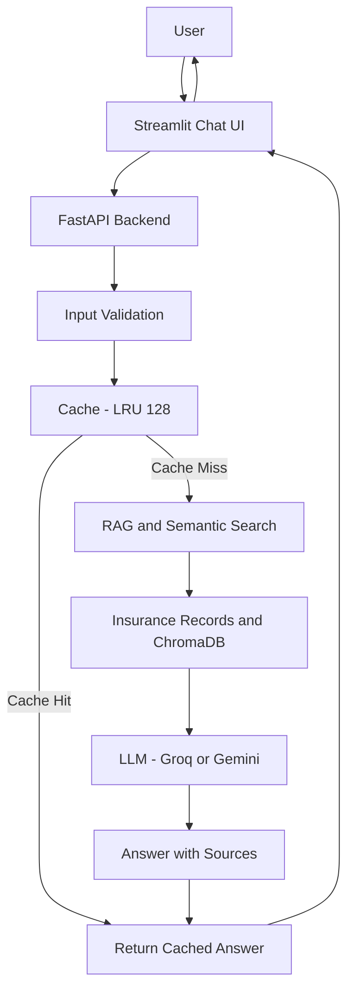

# InsureClear
[](https://github.com/IshwariBagal05/GenAITraining/actions/workflows/ci.yml)

## Project Overview

InsureClear is a GenAI-powered insurance information assistant that helps users understand insurance rules, policyholder rights, deadlines, and complaint procedures using information from official IRDAI sources.

It combines Retrieval-Augmented Generation (RAG), semantic search, and LLM-based question answering to provide simple, source-grounded insurance information.

## Problem Statement

Insurance rules and policyholder rights are spread across multiple official webpages and documents. Users may struggle to find accurate information about policy conditions, claim procedures, deadlines, and grievance channels.

InsureClear addresses this problem by organizing insurance information and allowing users to ask questions in natural language. It retrieves relevant information and generates answers supported by source references.

## Key Features

- Natural-language insurance question answering.
- Retrieval of relevant information from insurance records.
- Semantic search using vector embeddings.
- Source references for answers.
- Insurance records search and lookup.
- Chat interface built with Streamlit.
- LLM integration with Groq and Gemini.
- Response caching and request monitoring.
- Input validation and prompt-injection protection.
- Live API deployment on Render.

## Technology Stack

| Component | Technology |
|---|---|
| Programming language | Python |
| API framework | FastAPI |
| User interface | Streamlit |
| LLM providers | Groq, Gemini |
| Vector database | ChromaDB |
| Retrieval | RAG and semantic search |
| Data format | JSON |
| Testing | Pytest |
| Code quality | Ruff |
| Containerization | Docker |
| CI | GitHub Actions |
| Deployment | Render |

## System Architecture



## Project Structure

```text
GenAITraining/
├── app/
│   ├── main.py
│   ├── llm.py
│   ├── chat.py
│   ├── records.py
│   ├── smart_search.py
│   └── vectorstore.py
├── data/
├── prompts/
├── tests/
├── ui/
├── docs/
├── eval/
├── Dockerfile
├── docker-compose.yml
├── requirements.txt
└── README.md
```

## How to Run

1. Clone the repository.
2. Create and activate a virtual environment.
3. Install dependencies:

```bash
pip install -r requirements.txt
```

4. Copy `.env.example` to `.env` and configure your Groq or Gemini API key.
5. Start the API:

```bash
uvicorn app.main:app --reload
```

6. Open the API documentation at `http://localhost:8000/docs`.

To start the Streamlit interface separately:

```bash
streamlit run ui/app.py
```

## Data Sources

Insurance information is collected from official IRDAI policyholder resources and Bima Bharosa complaint-related resources.

## Disclaimer

InsureClear is an educational and informational project. Its responses are not legal or financial advice. Users should verify important decisions with official IRDAI publications and their insurance provider.
## Production Notes (Day 13)

### Performance and Usage

Tested locally using Groq (`openai/gpt-oss-120b`) with the same question submitted twice.

| Metric | First Request | Second Request |
|---|---:|---:|
| Response latency | 1435.61 ms | 0.01 ms |
| Cache status | Miss | Hit |
| LLM call | Yes | No |
| Input tokens | 995 | Cached |
| Output tokens | 419 | Cached |
| Total tokens | 1414 | Cached |

### Production Improvements

- **Latency and token logging:** Records request latency, input tokens, output tokens and total tokens.
- **Response caching:** LRU cache with a maximum capacity of 128 entries.
- **Input validation:** Questions must contain 3–2000 characters.
- **Prompt injection protection:** User questions are kept separate from system instructions.
- **Testing:** 14 automated tests passed; Ruff checks passed.

### Measurement Note

These latency values come from one local test, not a production load test. The second request was served from cache without another LLM call.

## Evaluation Results (Day 13)

| Evaluation Metric | Result |
|---|---:|
| Automated tests | 14 passed |
| Ruff checks | Passed |
| Semantic Search Configuration A | 80% (12/15) |
| Semantic Search Configuration B | 73% (11/15) |
| First request latency | 1435.61 ms |
| Cached request latency | 0.01 ms |
| Cache capacity | 128 entries |
| Maximum question length | 2000 characters |

Note: Latency results are from a single local test. Semantic search results are based on a 15-question evaluation dataset.
