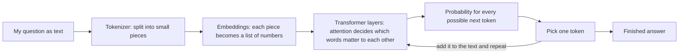

# How LLMs Work (in my own words)

A large language model (LLM) is a program that has read a huge amount of text
and learned to predict which piece of text is likely to come next. Everything
it does, including answering questions, comes from that one skill.

## The steps, from my question to its answer

1. **Tokenizing.** The text is cut into tokens, which are words or parts of words.
   "Insurance" may be one token, while a rare word is split into several.
2. **Embeddings.** Each token is turned into a list of numbers. Tokens with
   similar meaning get similar numbers.
3. **Attention.** In each transformer layer, every token looks at the other
   tokens and decides which ones matter for its meaning. In "the insurer
   rejected the claim because it was late", attention helps link "it" to "claim".
4. **Prediction.** The model gives a probability to every possible next token
   and picks one. It adds that token to the text and repeats until the answer is done.

## Training vs using it

- **Training** is the slow, expensive part. The model reads huge amounts of text,
  guesses the next token, is told how wrong it was, and adjusts its internal
  numbers (its weights) a tiny bit. This repeats billions of times.
- **Inference** is when I ask a question. The weights are frozen, and the model
  only does the prediction loop above.

## What it cannot do well

- It can **make things up** (hallucinate) because it produces likely-sounding
  text, not checked facts.
- Its knowledge **stops at a cutoff date**, so newer rules are unknown to it.
- It has no built-in link to my policy documents or to IRDAI's pages.

## Why this matters for InsureClear

Insurance rules have exact day counts (15 vs 30 days) and change over time, so a
guess that sounds right can mislead a policyholder. InsureClear therefore looks
up the rule in IRDAI-based records first and shows the source, instead of letting
a model answer from memory. My TF-IDF search is the simple version of this
look-up step.